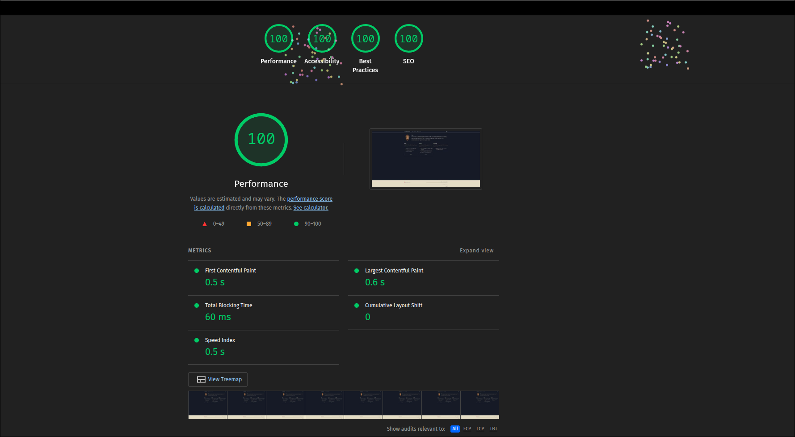

A technical deep-dive into the architectural decisions and tech stack choices made during the development of konradfedorczyk.dev.

## Context

I needed a simple, blog-style page to track my progress. I wanted something I could develop quickly without the need for specialized cloud hosting. My goal was to present mostly text-based content, supplemented by images and a few videos, while ensuring everything is presented in a clean, organized way.

## Decisions

- Framework: <a href="https://astro.build/" target="_blank">Astro</a> I chose Astro because it is an HTML-first ecosystem that is incredibly fast, while still allowing me to integrate frameworks like React or Sines in the future.
- Content Generation: <a href="https://en.wikipedia.org/wiki/Static_site_generator" target="_blank">Static Site Generation (SSG)</a> Static files are dirt cheap to host, and this type of architecture is highly secure and virtually maintenance-free.
- Coding Harness: <a href="https://opencode.ai/" target="_blank">Opencode</a> A great free option that allows me to connect directly to my local AI server.
- Styling: <a href="https://sass-lang.com/" target="_blank">Sass</a> I wanted to use plain CSS, but I still needed features like variables for media queries.
- Local AI Model: <a href="https://ollama.com/library/qwen3.8" target="_blank">qwen3.8</a> Currently the best model for coding that fits entirely within the VRAM of my GPU.
- Design Tool: <a href="https://penpot.app/" target="_blank">Penpot</a> A free, open-source alternative to Figma that I can easily self-host.

## Consequences

- <strong>Zero-cost hosting</strong>: I can host the site for free on my OVH server, which was bundled with my domain purchase.
- <strong>Near-perfect performance</strong>: I achieved 100% Lighthouse scores across most categories. The mobile homepage scored 98%—a tiny trade-off for the 3D model, because I really wanted some eye-candy!
- <strong>Maintainability</strong>: Most of the code is plain HTML, CSS, and vanilla JavaScript. This means I can easily update or re-theme the site in a few years without a massive overhaul.

## TODO

- Styles require some unification (layouts have different widths etc.).
- Split content by taxonomies.
- UX improvements.
- More breakpoints.

## Summary

After years of working with Gatsby, Next.js, and React, I’ve come to believe that modern web development has gone too far with its abstractions. While I recognize the advantages of a declarative approach, there are times when sticking to the basics is simply better.

Using plain HTML and CSS, supplemented by a little vanilla JavaScript, results in a site that is incredibly fast and free from the usual debugging headaches.

From a security standpoint, this approach drastically reduces the attack surface; the only real vulnerability is the web server itself. Ultimately, this simplicity means I understand every line of code in my project, allowing me to maintain and optimize it with ease.

“The ability to simplify means to eliminate the unnecessary so that the necessary may speak. ”
― Hans Hofmann

